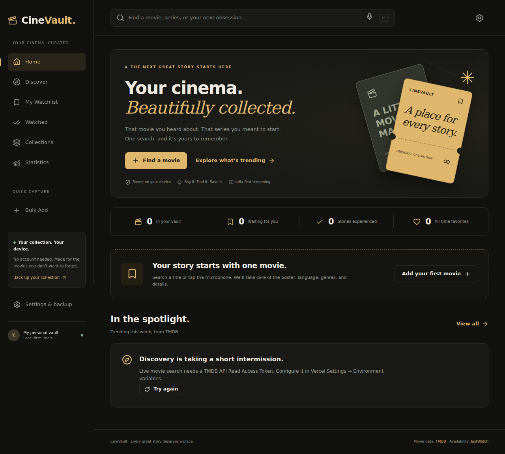
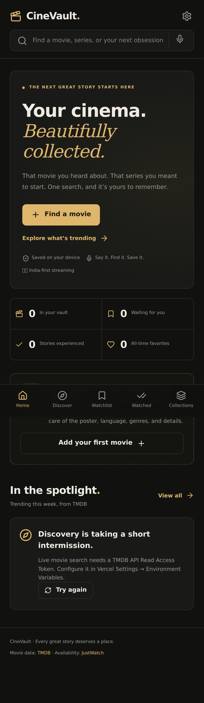

# CineVault

A local-first personal movie and television vault. Search a full or partial title, choose the correct version, and save its metadata in one click. Original languages and genres become dynamic collections automatically. Voice capture makes it quick to save a movie you hear about on the go.

## Features

- Next.js App Router application with a responsive charcoal and amber interface, desktop sidebar, Android bottom navigation, dark/light themes, accessible Radix dialogs, and reduced-motion support.
- Live TMDB multi-search: debouncing, cancellation, native-script titles, release-year ranking, movie/series disambiguation, keyboard navigation, and quick add. No Google scraping or production sample movie arrays.
- Browser speech recognition with configurable English, Tamil, Hindi, Telugu, Malayalam, and Kannada recognition. Say “add Vikram to my watchlist”; choose the matching result. Unsupported browsers retain text search. Voice is title capture, not an LLM voice assistant. Voice recordings are not stored by CineVault; the browser speech service may process audio online.
- TMDB details, posters, backdrops, genres, original/spoken languages, cast, directors/writers, production information, trailers, alternative titles, and TV season summaries.
- Separately labeled IMDb ratings through optional OMDb. Missing IMDb information stays unavailable; TMDB is never substituted.
- India-first regional watch availability through TMDB/JustWatch, distinguishing subscription, free, ads, rental, and purchase. Source-provided regional links; no invented direct OTT links, dubbed languages, or subtitles. Manual refresh bypasses the normal upstream cache.
- IndexedDB collection, statuses, watched date, rewatches, personal ratings, favorites, notes, preferences, unlimited custom lists, cover selection, membership in multiple lists, and reordering.
- Combined language/genre/platform/status/type/year/decade/runtime/rating/country/favorite/list filters and eleven sorting choices.
- Dynamic language, genre, IMDb 8+, unwatched, watched-this-month, recently added/released, runtime, and provider collections.
- Live trending, popular, top-rated, upcoming, TV, regional and genre discovery. Explainable recommendation ranking uses saved/favorite titles, preferred languages, genres and TMDB recommendations, excludes all already saved titles, and deduplicates candidates.
- Bulk title capture (up to 200 lines): sequential bounded requests, review ambiguous matches, progress, duplicate skipping, stop, and retry failures.
- Reactive collection statistics: media/status counts, average personal rating, favorite genres, language distributions, monthly/yearly watched counts, movie runtime with recorded rewatches, ratings, and watched decades.
- Versioned JSON backup with annotations, preferences and list relationships. CSV includes serialized metadata and entry columns for restoring records and notes; JSON is required for list relationships. Merge preserves existing annotations; replace requires a separate explicit confirmation. Partially invalid records are reported and skipped.
- Installable PWA, home-screen capture shortcut, Android share target, offline saved collection editing, cached application shell, bounded poster cache, and optional browser storage persistence.
- Optional authenticated Neon/Drizzle sync with server-verified Neon account identity, owner-scoped queries, durable offline outbox, incremental cursors, revisions, tombstones, idempotent mutations, optimistic conflict detection, and explicit conflict resolution.

## Screenshots

The screenshots show the actual empty collection with API credentials unconfigured.





## Stack and architecture

Node.js 24, Next.js 16, React 19, strict TypeScript, Tailwind 4, shadcn-style local Button and Radix Dialog primitives, Lucide, Motion, Dexie, Zod, Papa Parse. Optional PostgreSQL uses Neon, Drizzle, and managed Neon Better Auth with email/password login and signed HttpOnly sessions.

```
app/                     Pages, manifest and server API routes
components/              Search, movie cards/details, collections, settings, stats
components/ui/           Reusable accessible primitives
lib/api/                 Validated TMDB/OMDb adapters, caching and request guards
lib/db/                  IndexedDB schema and transactional collection operations
lib/filters/             Reusable filters, sorts and deterministic recommendations
lib/import-export/       Versioned validation and transactional restore
lib/sync/                Optional auth, Drizzle schema, protocol and client outbox
migrations/              Optional PostgreSQL migration
public/                  Service worker, original app icons
scripts/                 Database migration and production smoke check
tests/                  Deterministic unit/integration tests (not app data)
e2e/                     Desktop and Android Playwright workflows
```

### Local setup

```bash
git clone https://github.com/Kanish2002/Cinevault.git
cd Cinevault
npm ci --legacy-peer-deps
cp .env.example .env.local
# Configure TMDB_API_READ_ACCESS_TOKEN in .env.local
npm run dev
```

Open `http://localhost:3000`. For the production service worker, run `npm run build` and `npm run start`. The PWA requires localhost or HTTPS. No database or sign-in is required for local collection management. Search and fetching new metadata require internet and TMDB configuration. A real exported collection can be imported without movie API credentials.

## Environment variables

All credentials are server-only. Never use `NEXT_PUBLIC_` for these values, commit `.env.local`, or paste secrets into source files.

| Variable                     | Required              | Purpose                                                                           |
| ---------------------------- | --------------------- | --------------------------------------------------------------------------------- |
| `TMDB_API_READ_ACCESS_TOKEN` | Live search/discovery | TMDB v3 Bearer API Read Access Token (not the v3 API key)                         |
| `OMDB_API_KEY`               | Optional              | OMDb IMDb rating lookup by IMDb ID                                                |
| `DATABASE_URL`               | Cloud only            | Neon PostgreSQL connection string                                                 |
| `NEON_AUTH_BASE_URL`         | Cloud only            | Managed Auth URL; also accepts integration-provided `DATABASE_NEON_AUTH_BASE_URL` |
| `NEON_AUTH_COOKIE_SECRET`    | Cloud only            | Random secret of at least 32 characters for signed HttpOnly session cookies       |

The app exposes only configuration booleans at `/api/config`. Missing TMDB yields an actionable 503 response. Missing OMDb does not block saves. Missing cloud configuration disables sign-in and sync while keeping local mode usable.

### TMDB setup

1. Sign in at <https://www.themoviedb.org/settings/api> and register an API application under the applicable terms.
2. Copy **API Read Access Token** to `TMDB_API_READ_ACCESS_TOKEN` in the local environment and the CineVault Vercel project's Production environment.
3. Redeploy after changing Vercel environment variables.
4. Check `/api/config`, then search for Vikram, Interstel, Drishyam, and a native-script title. Configuration booleans do not validate the credential itself.

### OMDb setup

Obtain an authorized key from <https://www.omdbapi.com/apikey.aspx>, set `OMDB_API_KEY`, and redeploy. Usage quotas, terms, and freshness apply. IMDb IDs are obtained from TMDB external identifiers; ratings and votes come from OMDb. Failures remain explicitly unavailable/error states.

### API endpoints and caching

- `GET /api/search?q=…`: validated 1–160 character search, 5-minute upstream cache.
- `GET /api/media/{movie|tv}/{id}?region=IN`: typed details, external IDs, credits, trailer, images, IMDb ratings, and providers. Metadata cache: 24 hours; OMDb: 24 hours; provider data: 6 hours.
- `GET /api/media/{type}/{id}?region=IN&refresh=1`: bypass upstream caches for a user-requested refresh.
- `GET /api/media/{type}/{id}/providers?region=IN`: regional availability.
- `GET /api/media/{type}/{id}/ratings`: separately labeled ratings.
- `GET /api/discover?kind=trending|popular|top|upcoming|tv|regional|genre|similar`: live discovery with validated page and filter parameters.
- `GET /api/recommendations?type=movie&id=…`: source recommendation candidates; personal scoring stays local.
- `POST /api/sync`: authenticated, same-origin, validated changes and incremental pull.

Provider fetches use ten-second timeouts, in-flight deduplication, at most two attempts for transient failures, and friendly 429 errors. The per-instance API guard permits 120 requests/minute/IP. It is a best-effort guard in serverless environments; use Vercel Firewall or a shared limiter for strong cross-instance enforcement. Never describe cached provider data as guaranteed current availability. The UI displays the retrieval time and flags stale data; manual refresh queries the provider again.

## IndexedDB design and migrations

Database `cinevault`, schema version 1:

| Table         | Role                                                       |
| ------------- | ---------------------------------------------------------- |
| `media`       | Canonical `movie:TMDB_ID` or `tv:TMDB_ID` metadata         |
| `entries`     | One unique library annotation record per media ID          |
| `lists`       | Independent custom list records                            |
| `items`       | Unique `(listId, mediaId)` reference and position          |
| `preferences` | Region, theme, default status/sort, voice/language choices |
| `outbox`      | Durable unsent mutation, base revision and mutation UUID   |
| `sync`        | Last known remote revision and record snapshot             |
| `state`       | Owner binding, cursor and unresolved conflict snapshots    |

Additions, removals, list edits and restores use Dexie transactions. Duplicate adds do not reset status, notes, favorites, ratings, or added date. Deleting a list removes memberships, not media. Browser restarts preserve IndexedDB in the same profile; clearing site data, private browsing, profile deletion, app uninstall, or browser eviction can erase it. `navigator.storage.persist()` is available in Settings; denial is handled normally. Poster URLs are stored in metadata, not image blobs.

When changing schema, retain `version(1)` and add a new `version(2).stores(...).upgrade(...)`. Do not rename the database or clear it during upgrades. Test migrations against an existing version-1 fixture and export a backup before significant migrations. No migration is needed for this initial schema.

## Backup and recovery

Settings → Export JSON generates a complete version-1 backup. The “last backup generated” timestamp records generation and download initiation, not proof that the operating system retained the file. Store a copy outside the browser. Import validates the envelope, canonical IDs, each record and relationships; invalid records are listed. Merge skips existing titles and preserves their current annotations while adding valid new list relationships. Replace requires a second confirmation and emits sync tombstones for removed records. CSV round trips CineVault media/entry data and quoted Unicode notes; plain title lists should use Bulk Add, and custom lists require JSON.

## Optional Neon sync

1. Connect Neon PostgreSQL and enable **Managed Better Auth** on the same Neon branch. The Vercel integration provides `DATABASE_URL` and `DATABASE_NEON_AUTH_BASE_URL`; alternatively set `NEON_AUTH_BASE_URL` from Neon → Branch → Auth → Configuration.
2. Keep **Email and password** enabled in Neon Auth. Add `https://cinevault-kanish-tech.vercel.app` as a trusted domain in Neon Auth settings; add `http://localhost:3000` for local development. Google OAuth credentials and Google Cloud Console are not required.
3. Set `NEON_AUTH_COOKIE_SECRET` in Vercel Production and Preview to a securely generated random 32-byte value, then redeploy. Never commit the secret. `/api/config` reports configuration presence; it does not prove authentication or database access.
4. Open Settings → Optional cloud sync → **Create account**. Use any email, including Gmail, and a separate CineVault password of at least 10 characters. The password is managed and hashed by Better Auth, never saved in the local vault or backups. Sign in on another device with the same email and CineVault password.
5. Enable sync for the local vault on each device. The first authenticated sync creates the sync schema automatically and upgrades the existing kind constraint to include preferences, preserving existing records. `npm run db:migrate` remains available for manual administration.
6. **Forgot password?** requests a six-digit email reset code through Neon's email OTP plugin. Email delivery depends on Neon Auth's SMTP configuration and limits. Neon's shared sender supports OTP for testing; configure your own SMTP provider for production delivery. If email verification is required in Neon, a verification flow must be configured before enforcing it; the default account flow here assumes verification is disabled.

The server derives ownership as `neon:<managed-user-id>` from its authenticated session, never from a supplied email or user ID. Every Neon read/write is scoped to that immutable account ID. A client-supplied expected account is compared against the verified session solely to reject account switches during an in-flight sync. Owner advisory locks serialize writes, base revisions prevent lost updates, tombstones propagate deletion, mutation UUIDs make retries idempotent, and cursors pull updates incrementally. Pending offline edits remain until acknowledged. Manual and background sync requests are deduplicated. Changes sync every 30 seconds while the app is open and on connectivity restoration. Conflicts offer “keep this device” or “use cloud”.

Cloud data includes movie/TV metadata (including cached rating/provider information), saved entries, statuses, notes, personal ratings, favorites, watched date, rewatch count, custom lists, list membership/order, and shared preferences: region, theme, default status/sort, preferred languages and voice language. Sync consent and last-backup timestamp stay device-specific. Provider information is cached metadata and can expire; it is not guaranteed current availability. Sync is not a replacement for backups.

**Account changes and older vaults:** Old GitHub/Google sessions cannot access the sync API, and identities are never automatically linked by email. A local vault remains bound to its original owner. Export its JSON backup, use a separate browser profile for the new account, import the backup, and explicitly enable sync. Existing cloud records stay under their original owners; no automatic transfer occurs.

**Verification:** Automated tests cover account IDs, auth proxy policy, unauthenticated/cross-origin/mismatched-account rejection, owner-scoped SQL, preference sync, conflicts, duplicate-request suppression, registration and recovery UI, and offline preservation. Intercepted browser tests do not prove live authentication or email delivery; validate actual registration, sign-in and two-device sync against the deployed app. Per-episode TV progress and a dated rewatch-event journal remain future extensions.

## PWA and offline behavior

The service worker precaches core pages and their application assets, serves navigation network-first, caches immutable static chunks, and retains at most 500 poster requests. API, auth, sync and RSC responses are not cached by the service worker. Online navigation loads current code; versioned caches clear old shells after an update. The first online load must finish before offline launch works. Saved collection data is independent of API availability. Install in Chrome Android via “Install app” / “Add to Home screen”; the capture shortcut focuses search. Shared text is editable: CineVault cannot reliably identify a movie from an arbitrary Instagram URL alone.

## Testing

```bash
npm run lint
npm run typecheck
npm run test
npm run build
npx playwright install --with-deps chromium
npm run test:e2e
```

Vitest uses fake IndexedDB and documented API-contract fixtures. Tests cover duplicate races, reopen persistence, statuses, multi-list integrity, reordering, tombstones, preferences, classifications, filter combinations, stale providers, sorting, recommendations, backup recovery, merge, invalid schemas/rows, CSV Unicode, adapters, IMDb degradation, real source-field mappings, missing keys and basic UI semantics.

Playwright runs production-mode workflows in desktop Chrome and Pixel 7 viewports: quick add, language grouping, same-title disambiguation, partial search, duplicate handling, reloads, notes/ratings/statuses, custom lists, combined filters, export/merge, fresh-profile JSON recovery, unsupported voice handling, honest API errors, mobile overflow, and offline reload/editing. Fixtures are intercepted only in tests and never shipped as production movie search results. Microphone hardware and the external speech service require manual device testing.

GitHub Actions runs lint, types, unit/integration tests, build, and browser tests on main and pull requests. API secrets are unnecessary for deterministic CI.

For a real deployment, run `BASE_URL=https://YOUR_HOST npm run test:production` after installing Chromium. This uses an isolated test browser profile and a clearly synthetic backup record to verify production IndexedDB import, reload, status changes and Android-sized layout without touching your browser collection. Live provider checks still require valid credentials.

## Deployment

The intended Vercel project is `cinevault`, linked to `Kanish2002/Cinevault` on main. Next.js is detected explicitly; production builds use `npm run build`, installation uses the lockfile with `npm ci --legacy-peer-deps`, and server functions run near India in `bom1`. Use the actual assigned production domain; do not assume `cinevault.vercel.app` is available.

After adding credentials in Vercel Project Settings → Environment Variables, redeploy. Test the home page, `/api/config`, search, detail fetching, add/reload, settings export and Android layout. Follow-up pushes to main deploy through Vercel Git integration. Deployment status and credential blockers are recorded in `DEPLOYMENT.md`.

## Attribution and licensing

This product uses the TMDB API but is not endorsed or certified by TMDB. Availability is powered by JustWatch through TMDB, with regional links from the response. IMDb information is retrieved through OMDb when authorized. Movie images and metadata remain subject to their providers' terms. CineVault's original app icon and UI are not copied website assets. Respect provider licensing and usage limits, especially if making the application commercial.

Primary API references:

- <https://developer.themoviedb.org/docs/finding-data>
- <https://developer.themoviedb.org/reference/tv-series-watch-providers>
- <https://www.omdbapi.com/>
- <https://nextjs.org/docs/app/guides/progressive-web-apps>

## Troubleshooting and limitations

- **Search 503:** set a valid TMDB Read Access Token in the correct environment and redeploy. Saved collections remain usable.
- **IMDb unavailable:** configure OMDb or check its quota. TMDB ratings are separate.
- **Provider information missing:** the source may have incomplete coverage. Missing/error data does not mean the title is unavailable. Region, refresh age, and audio/subtitle uncertainty are explicit.
- **Wrong language edition:** choose the year, language and media type from suggestions. No silent ambiguous auto-save.
- **No voice input:** use a supported HTTPS browser, grant microphone permission, select recognition language in Settings, and retain text fallback. Recognition is dependent on the browser/device and may require internet.
- **Storage unavailable:** allow IndexedDB, avoid private browsing, check quota, and restore from a backup. Poster cache quota failures must not be mistaken for collection failures.
- **Cloud disabled or 401:** configure all cloud variables/migration and sign in again. Local mode is independent.
- **Cloud conflicts:** review versions explicitly. No last-write-wins overwrite of unacknowledged local edits.
- **Offline first visit:** the app must be loaded online once to cache its shell. Live search/discovery are online-only.
- **API abuse:** the request guard is per-instance. Add shared rate limiting if hosting a high-traffic public service.

Future optional work: per-episode viewing progress, a dated rewatch journal, cloud-synced preferences, more elaborate typo candidate generation, durable shared rate limits, route-level bundle splitting/virtualization beyond incremental card rendering, and advanced voice conversation. These should not compromise the local-first collection or introduce paid AI dependencies for ordinary title search.
